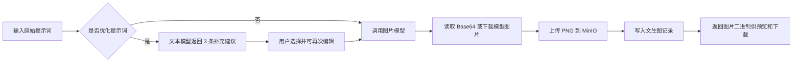
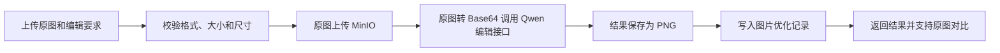

# SproutTrail

SproutTrail 是一个轻量级 AI 图片创作工作台。用户登录后可以直接使用文字生成图片，也可以先让文本模型给出提示词补充建议，或上传已有图片进行 AI 优化。生成结果和业务记录分别保存到 MinIO 与 MySQL，并按登录用户隔离历史数据。

## 核心功能

- 用户注册、登录、退出与登录态校验
- 文字生成图片，支持直接使用原文或追加 AI 提示词建议后生成
- 文生图风格预设，支持写实摄影、电影感、动漫、水彩、3D 和极简海报
- 图片优化，支持上传 JPG/PNG 原图并提交编辑要求
- 画幅选择：自动、1:1、16:9、9:16、4:3
- 图片在线预览、原图/结果对比和 PNG 下载
- 按用户查询文生图、图片优化历史，支持分页、提示词复制和继续创作
- 模型、存储、参数校验等异常统一转换为前端可读的 JSON 错误

## 核心业务逻辑

### 1. 身份认证与数据隔离

1. 用户注册时，服务端校验用户名和密码，并使用 BCrypt 保存密码哈希。
2. 登录成功后，Sa-Token 创建会话并返回 `tokenValue`。
3. 前端将 token 保存到 `sessionStorage`，后续请求通过 `satoken` 请求头携带。
4. 除注册和登录外，所有 `/api/**` 接口都由 Sa-Token 拦截器校验登录状态。
5. 图片记录查询与下载始终使用服务端会话中的用户 ID，不接受客户端指定用户 ID。

静态页面本身可以公开访问，但工作台和历史页加载后会调用 `/api/auth/token` 校验会话；无效会话会跳转到登录页。

### 2. 提示词优化与文生图



- 提示词优化只生成三条“补充内容”，不会覆盖原始提示词，也不会触发图片生成。
- 模型输出必须包含恰好三条合法建议；服务端会校验标题、补充内容和 JSON 结构。
- 用户可以跳过优化，直接使用原文生成。
- 用户可以选择一个风格预设；前端会将对应的可见风格描述追加到 `supplement`，因此无需新增接口字段，最终提示词和历史记录都会保留实际使用的风格内容。
- 风格预设只作用于文生图；选择 AI 建议时，风格描述会追加在用户确认的建议之后，二者合计不能超过 1200 个字符。
- 选择建议时，最终提示词为 `原始提示词 + 两个换行 + 用户确认的补充内容`。
- 文生图默认使用 `SQUARE`（1024×1024）；不同画幅对应不同的图片模型实例，并按画幅缓存。
- 模型可返回 Base64 或 HTTPS 图片 URL。服务端读取图片后使用 UUID 命名，存入 `{userId}/{uuid}.png`，随后写入 `image_generation_record`。

### 3. 图片优化



- 只接受单张 JPG/PNG，最大 5 MB。
- 宽高必须在 1～8000 像素之间，总像素不超过 1600 万，长边不能超过短边的 10 倍。
- 服务端根据真实图片内容识别格式，不信任文件扩展名或客户端声明的 MIME 类型。
- 编辑要求原样提交，并通过 `prompt_extend=false` 关闭模型侧提示词改写。
- 图片编辑使用 Qwen 兼容接口的 `/images/generations` JSON `image` 扩展字段；文生图仍通过 LangChain4j 的 `OpenAiImageModel` 完成。
- 原图与优化结果都会保存到 MinIO，成功后写入 `image_optimization_record`。若模型调用失败，服务端会尝试删除本次已上传的原图。
- 图片优化默认画幅为 `AUTO`。

### 4. 历史记录与下载

- 文生图与图片优化历史分开查询，并按创建时间、记录 ID 倒序排列。
- 分页默认每页 20 条，最大 50 条；服务端额外查询一条记录来计算 `hasMore`。
- 历史下载会同时校验记录 ID 和当前用户 ID，再从 MinIO 读取对应对象。
- 文生图历史支持复制原始/最终提示词和继续创作；图片优化历史同时展示原图与结果。

### 5. 错误处理

业务异常统一返回以下结构：

```json
{
  "timestamp": "2026-10-14T10:00:00Z",
  "code": "IMAGE_GENERATION_FAILED",
  "message": "图片生成失败，请稍后重试"
}
```

常见错误包括参数校验失败、未登录、上传文件过大、图片格式无效、模型调用失败、存储失败等。服务端日志不会记录完整提示词、图片 Base64 或认证信息。

## 技术栈

| 层级 | 技术 |
| --- | --- |
| 后端 | JDK 21、Spring Boot 3.5.16、Spring MVC |
| AI 调用 | LangChain4j 1.20.2、OpenAI 兼容接口、Qwen 图片编辑协议 |
| 鉴权 | Sa-Token、BCrypt |
| 数据访问 | MyBatis-Plus、MySQL |
| 对象存储 | MinIO |
| 前端 | HTML、CSS、原生 JavaScript |
| 构建 | Maven |

应用启用了 JDK 21 虚拟线程，用于承载图片模型等高延迟同步网络请求。

## 项目结构

```text
src/main/java/com/sprouttrail
├── auth/                 # 注册、登录、会话与用户数据
├── prompt/               # 提示词优化接口与模型输出解析
├── image/                # 文生图、图片优化、历史记录与模型适配
│   ├── adapter/          # Qwen 图片编辑协议适配
│   ├── controller/       # 图片相关 HTTP 接口
│   ├── model/            # 请求、响应、实体与画幅枚举
│   └── service/          # 图片工作流及历史记录逻辑
├── storage/              # MinIO 上传、下载和删除
└── common/               # 配置、统一异常和错误响应

src/main/resources
├── application.yml       # 应用、数据库、模型、MinIO 和 Sa-Token 配置
├── schema.sql            # 启动时初始化数据库表
└── static/               # 工作台、登录、注册和历史页面
```

## 数据模型

应用启动时会执行 `schema.sql`，使用 `IF NOT EXISTS` 创建以下表：

| 表 | 用途 | 关键字段 |
| --- | --- | --- |
| `user` | 用户账号 | 用户名、BCrypt 密码哈希、账号状态 |
| `image_generation_record` | 文生图历史 | 用户、原始提示词、最终提示词、结果 URL、画幅 |
| `image_optimization_record` | 图片优化历史 | 用户、原图 URL、编辑要求、结果 URL、画幅 |

## 配置说明

运行前需要准备 MySQL、MinIO，以及兼容 OpenAI 协议的文本/图片模型服务。主要配置位于 `src/main/resources/application.yml`：

| 配置项 | 说明 |
| --- | --- |
| `spring.datasource.*` | MySQL 地址、用户名和密码 |
| `app.image.api-key` | 模型服务 API Key |
| `app.image.base-url` | 图片模型兼容接口根地址 |
| `app.image.image-model` | 图片模型名称 |
| `app.image.prompt-model` | 提示词优化文本模型名称 |
| `app.image.prompt-base-url` | 文本模型接口地址；空值时复用图片接口地址 |
| `app.image.timeout` | 单次模型请求超时 |
| `minio.url` | MinIO 客户端连接地址 |
| `minio.endpoint` | 生成对象公开 URL 时使用的外部地址 |
| `minio.accessKey` / `minio.secretKey` | MinIO 凭证 |
| `minio.bucketName` | 图片存储桶名称 |

建议通过环境变量或外部配置文件覆盖敏感信息，不要把真实凭证提交到 Git。Spring Boot 常用环境变量示例：

> 安全提示：当前 `application.yml` 中存在直接填写的连接信息。如果这些凭证真实可用，请在发布仓库前轮换，并改用环境变量或外部配置文件。

```bash
export SPRING_DATASOURCE_URL='jdbc:mysql://127.0.0.1:3306/sprouttrail?useUnicode=true&characterEncoding=UTF-8'
export SPRING_DATASOURCE_USERNAME='sprouttrail'
export SPRING_DATASOURCE_PASSWORD='replace-me'
export APP_IMAGE_API_KEY='replace-me'
export APP_IMAGE_BASE_URL='https://your-model-service.example.com/v1'
export APP_IMAGE_IMAGE_MODEL='your-image-model'
export APP_IMAGE_PROMPT_MODEL='your-chat-model'
export APP_IMAGE_PROMPT_BASE_URL='https://your-model-service.example.com/v1'
```

MinIO 的配置键采用驼峰命名。为避免不同环境对环境变量映射方式存在差异，可以在外部 YAML 中配置，然后启动时加载：

```yaml
minio:
  url: http://127.0.0.1:9000
  endpoint: http://127.0.0.1:9000
  accessKey: replace-me
  secretKey: replace-me
  bucketName: sprouttrail
```

```bash
java -jar target/sprouttrail.jar \
  --spring.config.additional-location=file:/path/to/application-local.yml
```

> 当前上传逻辑会为 bucket 设置公共读策略，以便历史页面直接展示图片。生产环境如果不允许公开对象，应改为私有 bucket，并将历史图片访问改成后端转发或签名 URL。

## 本地运行

环境要求：

- JDK 21
- Maven 3.9+
- MySQL 8+
- MinIO
- 可用的文本与图片模型服务

完成配置后启动：

```bash
mvn spring-boot:run
```

或构建可执行 JAR：

```bash
mvn clean package
java -jar target/sprouttrail.jar
```

默认访问地址：

- 登录页：<http://localhost:8080/login.html>
- 注册页：<http://localhost:8080/register.html>
- 图片工作台：<http://localhost:8080/>
- 我的图片：<http://localhost:8080/history.html>

数据库账号需要具备建表权限；应用启动时会自动补建缺失的表。

## API 概览

除注册和登录外，以下请求均需携带请求头 `satoken: <tokenValue>`。

| 方法 | 路径 | 作用 | 响应 |
| --- | --- | --- | --- |
| `POST` | `/api/auth/register` | 注册账号 | `201 Created` |
| `POST` | `/api/auth/login` | 登录并获取 token | 登录信息 JSON |
| `POST` | `/api/auth/logout` | 注销当前会话 | 空响应 |
| `GET` | `/api/auth/token` | 校验并查询当前会话 | 会话信息 JSON |
| `POST` | `/api/prompts/optimize` | 获取三条提示词补充建议 | 建议 JSON |
| `POST` | `/api/images/generate` | 文字生成图片 | `image/png` |
| `POST` | `/api/images/edit` | 上传原图并优化 | `image/png` |
| `GET` | `/api/images/history` | 查询文生图历史 | 分页 JSON |
| `GET` | `/api/images/history/{id}/download` | 下载文生图结果 | PNG 附件 |
| `GET` | `/api/images/optimization-history` | 查询图片优化历史 | 分页 JSON |
| `GET` | `/api/images/optimization-history/{id}/download` | 下载图片优化结果 | PNG 附件 |

### 请求示例

获取提示词建议：

```bash
curl -X POST http://localhost:8080/api/prompts/optimize \
  -H 'Content-Type: application/json' \
  -H 'satoken: your-token' \
  -d '{"prompt":"清晨森林中的玻璃小屋"}'
```

生成图片：

```bash
curl -X POST http://localhost:8080/api/images/generate \
  -H 'Content-Type: application/json' \
  -H 'satoken: your-token' \
  -d '{
    "prompt":"清晨森林中的玻璃小屋",
    "supplement":"柔和的金色晨光，细腻的电影构图",
    "aspectRatio":"LANDSCAPE"
  }' \
  --output generated.png
```

优化图片：

```bash
curl -X POST http://localhost:8080/api/images/edit \
  -H 'satoken: your-token' \
  -F 'image=@/path/to/original.png' \
  -F 'prompt=保留主体和构图，改善光线并增强细节' \
  -F 'aspectRatio=AUTO' \
  --output edited.png
```

画幅枚举及模型尺寸：

| 枚举 | 尺寸 |
| --- | --- |
| `AUTO` | 模型自动选择 |
| `SQUARE` | 1024×1024 |
| `LANDSCAPE` | 1344×768 |
| `PORTRAIT` | 768×1344 |
| `LANDSCAPE_4_3` | 1152×864 |

## 当前实现边界

- 前端是由 Spring Boot 直接托管的静态页面，没有独立前端构建流程。
- 图片模型调用为同步请求；失败后由用户主动重试，图片编辑请求不会自动重试。
- MinIO bucket 当前会被设置为公共读。
- 项目目前没有自动化测试用例。
